# CareerPilot AI

A local-first job-search copilot delivered as a Chrome extension (Manifest V3). Upload a resume once, verify your profile, analyse jobs with a **transparent deterministic score**, tailor documents truthfully, review-and-fill application forms, and track every application. No backend and no paid AI are required.

> Architecture note: the dashboard is an **extension page** (React + Vite), not a Next.js site, because local-first data lives in the extension's IndexedDB and cannot be read from another origin. See `docs/ARCHITECTURE.md`.

## Screenshots
Captured from the built extension with sample data (a synthetic resume and three sample jobs).

| | |
|---|---|
| **Onboarding** — upload a resume, review and verify your profile<br>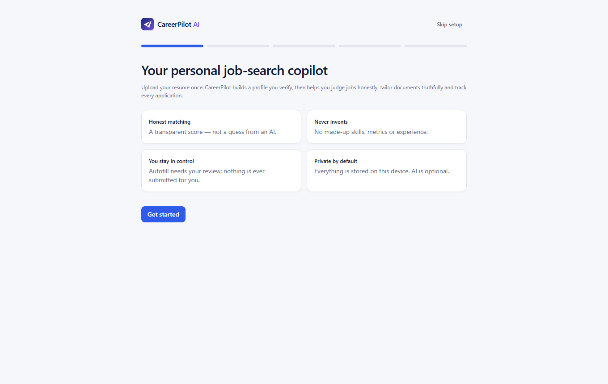 | **Profile review** — every parsed field is editable; skill levels are never auto-upgraded<br>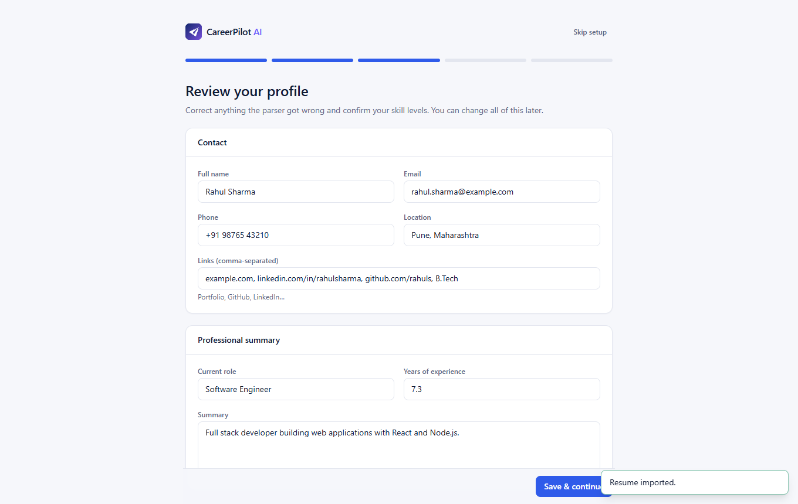 |
| **Dashboard** — KPIs, recommended jobs, follow-ups and interviews, activity<br>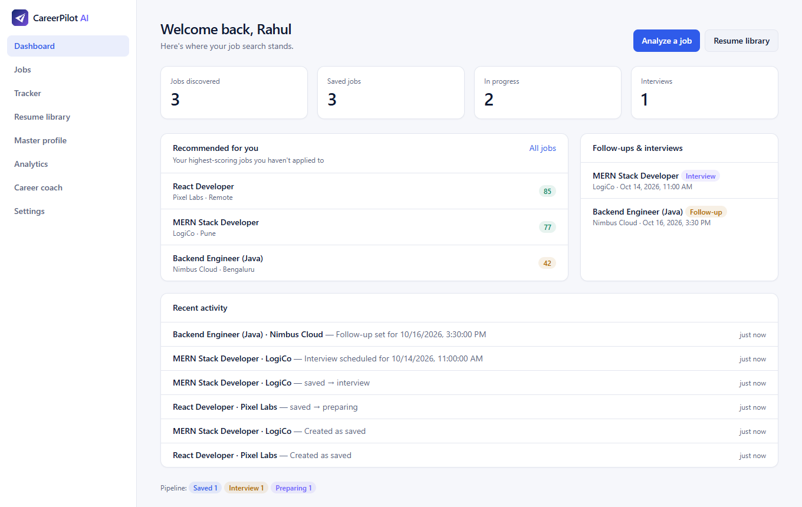 | **Job analysis** — transparent score breakdown, evidence, "not found in resume"<br>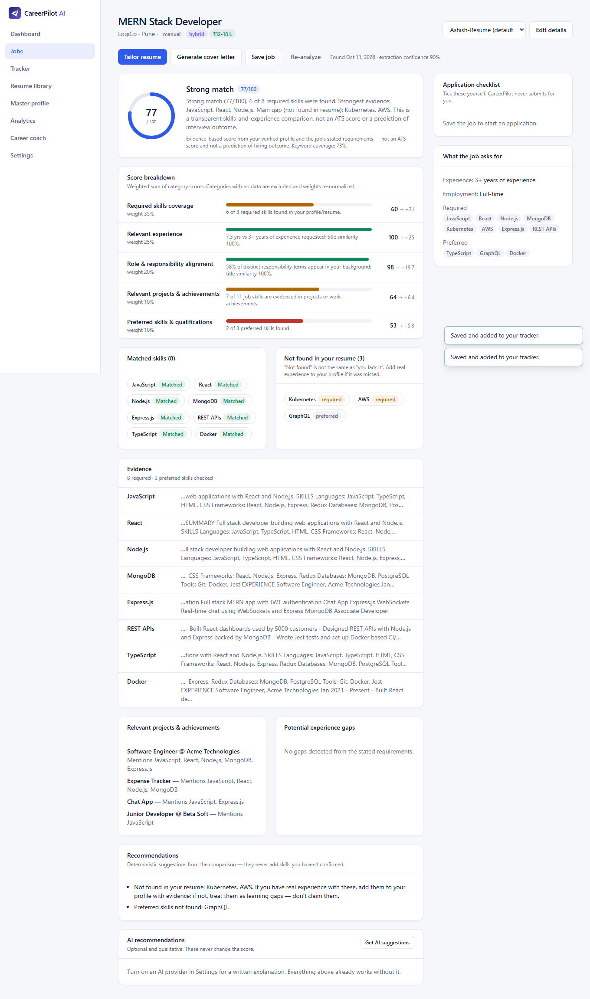 |
| **Tailored resume** — before/after comparison with truthfulness checks; LaTeX / DOCX / PDF export<br>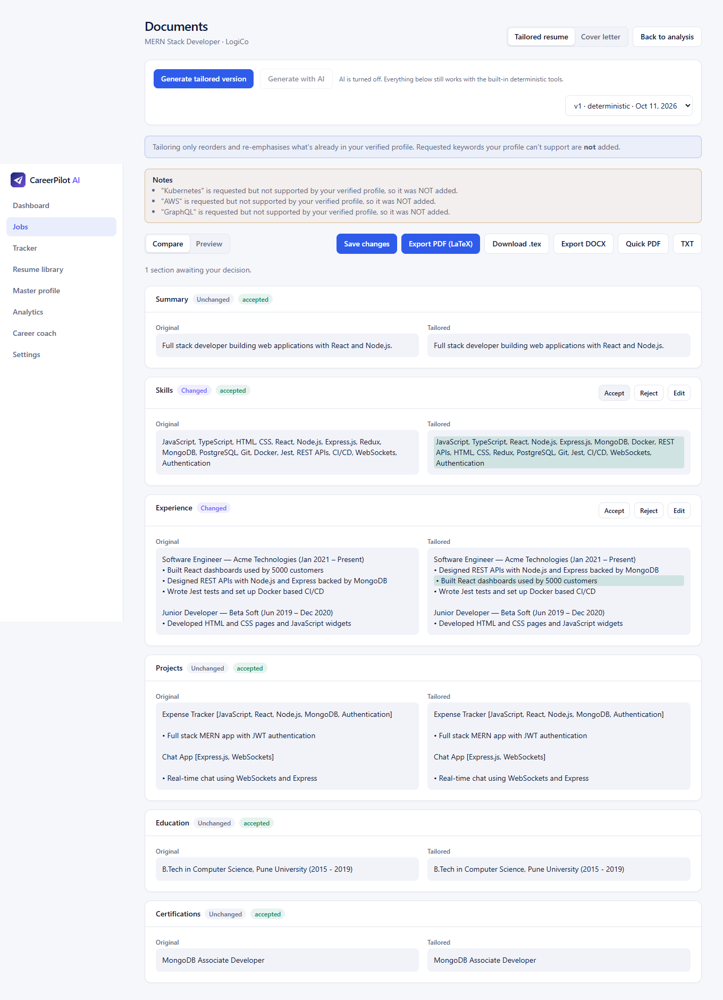 | **Tracker board** — statuses, interview and follow-up times, delete<br>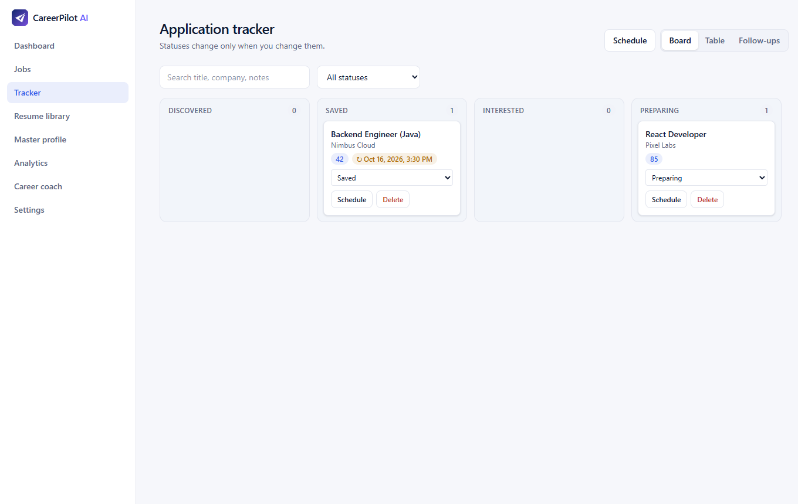 |
| **Follow-up calendar** — click a day to schedule a follow-up or interview (date + time)<br>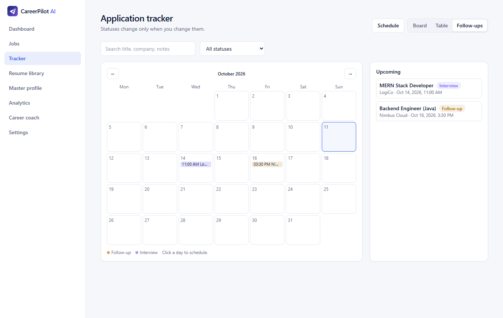 | **Jobs** — filters, ranked by match score, save / analyse / open<br>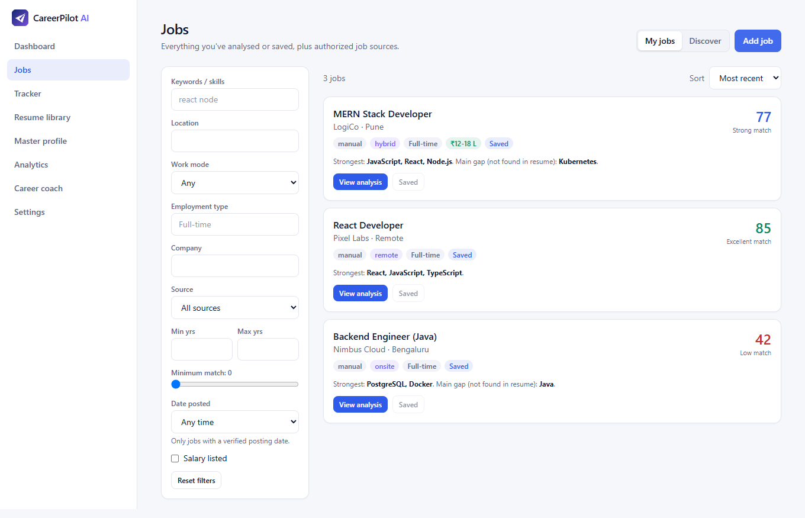 |
| **Analytics** — honest numbers, sample-size gating<br>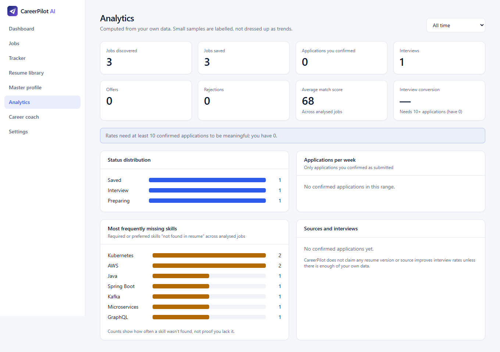 | **Settings** — AI provider, weights, reminders, privacy<br>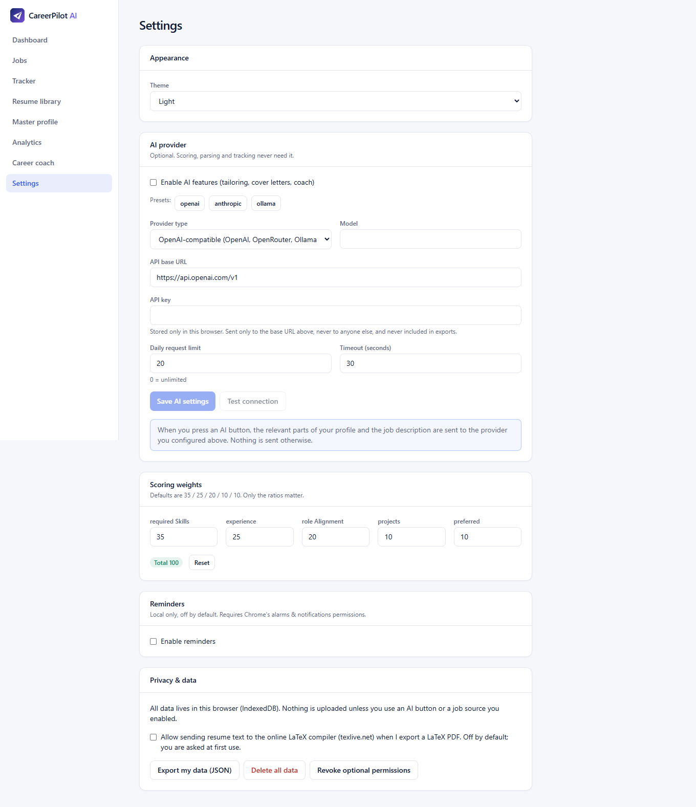 |
| **Dark theme**<br>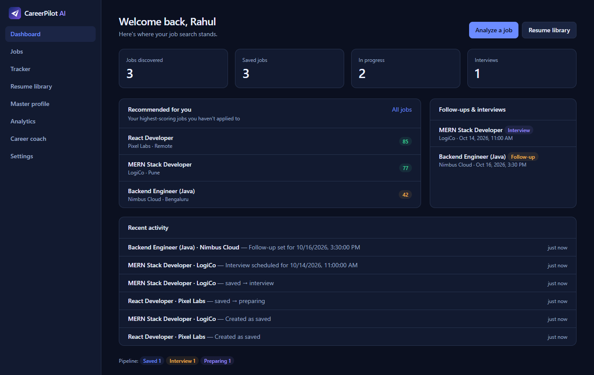 | **Popup** — analyse the current job from any page<br>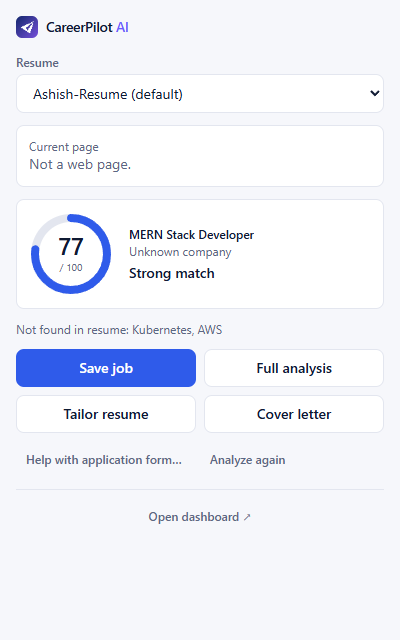 |

## Requirements
Node 20+ (tested on 22), pnpm 9+, Chrome 116+.

## Install, build, test
```bash
pnpm install
pnpm build                 # typecheck + builds apps/extension/dist
pnpm test                  # unit + integration (shared + extension)
pnpm --filter @careerpilot/extension exec playwright install chromium   # once
pnpm e2e                   # real Chromium with the built extension loaded
pnpm typecheck
pnpm audit                 # dependency audit (see docs/SECURITY.md for accepted findings)
```
Development: `pnpm dev` rebuilds on change (reload the extension in `chrome://extensions` after a rebuild).

## Load in Chrome
1. `pnpm build`
2. Open `chrome://extensions`, enable **Developer mode**.
3. **Load unpacked** → select `apps/extension/dist`.
4. The onboarding page opens automatically. Pin the extension to use the popup on job pages.

## Using it
- **Analyze a job:** open a posting → click the CareerPilot icon → *Analyze this job*. The page is read only when you click. If Chrome hasn't granted access, the popup shows *Allow on this site*. On **LinkedIn** the extension never reads the page: select the description text first, or paste it.
- **Paste fallback:** popup or dashboard → paste the description.
- **Tailor / cover letter:** from the analysis page. Works without AI (reordering existing content / template); AI is optional.
- **Autofill:** popup → *Help with application form…* → tick fields → *Fill selected*. Nothing is submitted for you.
- **Discover:** Jobs → Discover queries official public APIs (Remotive, Arbeitnow) after you grant that site permission, and builds search links for LinkedIn/Naukri/Indeed that you open yourself.

## Configure an AI provider (optional)
Settings → AI provider. Pick a preset or enter any OpenAI-compatible base URL (OpenAI, OpenRouter, a local Ollama at `http://localhost:11434/v1`) or Anthropic, a model and an API key. Chrome will ask permission for that one origin. The key is stored only in this browser, sent only to that URL, and excluded from exports. Set a daily limit; AI output is schema-validated, checked for invented skills/numbers, and always falls back to the deterministic tools on failure. Ollama needs `OLLAMA_ORIGINS=chrome-extension://*`.

## Layout
```
apps/extension/   MV3 extension: popup, dashboard (app), background worker, content script, adapters, discovery, storage
packages/shared/  pure TypeScript: schemas, skills, resume parser, job structuring, scoring, tailoring, autofill mapping, AI provider, analytics
docs/             PRODUCT_SPEC, ARCHITECTURE, IMPLEMENTATION_PLAN, SECURITY, TESTING, FEATURES
```
Not built (not required by implemented features): `apps/api`, `apps/web`, Postgres/Prisma, Redis. The `StorageAdapter` interface is the seam for a future backend.

See `docs/FEATURES.md` for the implemented / tested / pending checklist.
